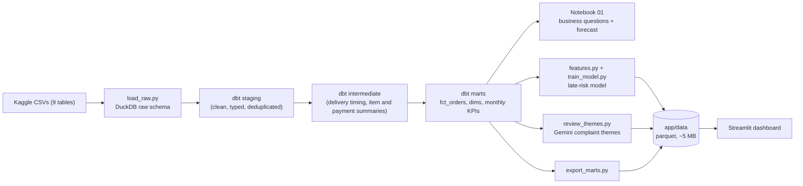

# E-commerce Delivery & Customer Experience Analytics

End-to-end analysis of 99,441 real orders from Olist, a Brazilian marketplace: I modelled the data with dbt and
DuckDB, measured how late deliveries hurt reviews, built a model that flags at-risk orders at purchase time,
used an LLM to classify customer complaints, and put it all in a Streamlit dashboard.

**Live dashboard:** _link coming soon_


## The business problem

I framed the project around a question an operations manager at Olist might ask:

> "Late deliveries seem to be hurting our customer reviews. How big is the problem, where does it come from
> (regions, sellers, product categories), and can we flag at-risk orders early?"

Everything in the repo is aimed at answering that question with numbers the business can act on.

## Data

[Brazilian E-Commerce Public Dataset by Olist](https://www.kaggle.com/datasets/olistbr/brazilian-ecommerce) on
Kaggle: about 100k orders placed from 2016 to 2018, in 9 tables (orders, items, payments, reviews, customers,
sellers, products, geolocation and a category translation). The dataset is published by Olist under the
[CC BY-NC-SA 4.0](https://creativecommons.org/licenses/by-nc-sa/4.0/) licence. All credit for the data goes to
Olist. The raw data is not included in this repo; a script downloads it.

## How it fits together



- **Warehouse:** DuckDB file (`warehouse/olist.duckdb`), built locally and not committed.
- **Modelling:** 17 dbt models in three layers, with 71 data tests (unique / not-null keys, relationships,
  accepted values, and custom checks such as "delivered before purchased"). 69 pass, and 2 warn on known
  source-data issues that I documented rather than hid.
- **Dashboard:** reads only the small parquet files in `app/data/`, so it can be deployed without the warehouse.


## What I found

1. **About 1 in 15 delivered orders is late, and lateness comes in spikes.** 6.77% of delivered orders arrived
   after the promised date (6,534 of 96,470). Three months (November 2017, February and March 2018) hold 48.4%
   of the late orders but only 21.7% of deliveries.
2. **Late orders get far worse reviews.** They average 2.27 stars vs 4.29 for on-time orders. Late orders are
   only 6.8% of deliveries, but they produce 32.5% of all 1–2 star reviews.
3. **Routes into the Northeast and Rio de Janeiro are the problem areas.** Alagoas (21.4%) and Maranhão (17.4%)
   have the highest late rates. The São Paulo to Rio route alone produced 1,152 late orders (14.1% late).
4. **Late orders are concentrated in a few sellers, mostly because sales are.** 98 sellers (3.3%) account for
   half of all late orders, but 128 sellers (4.3%) account for half of all deliveries. Those 98 are somewhat
   worse than average (8.1% late vs 5.8%).
5. **At-risk orders can be flagged at purchase, moderately well.** Reviewing the riskiest 10% of orders catches
   38.4% of late orders, 3.8 times better than random, tested on the most recent three months. The strongest
   signal is a short promised delivery time: Olist cut its median promise from 28 to 14 days in mid-2018.
   Because of that drift, gradient boosting did worse than a plain logistic regression on the newest data
   (ROC-AUC 0.65 vs 0.77).
6. **Many "not received" complaints are late orders.** I had Gemini read a random sample of 380 one- and
   two-star reviews. 37% are about delivery, and 62 of the 116 "not received" complaints were written while a
   late order was still on its way. About half of the "wrong item" complaints are actually items missing from
   multi-item orders, which points to a packing fix rather than a delivery fix.

Full write-ups: [reports/findings.md](reports/findings.md) (business questions, forecast, review themes) and
[reports/model_results.md](reports/model_results.md) (model, drivers, limitations).

**What I'd recommend:** warn customers before a delivery runs late, plan carrier capacity and pad promises
ahead of peaks, prioritise the SP → RJ and SP → Northeast routes with carriers, add a packing check for
multi-item orders, and use the risk score to give the operations team a short daily list of orders to check.

## How to run it

Requires Python 3.11. Everything runs locally; only the optional LLM step needs an API key.

### Mac / Linux

```bash
git clone https://github.com/SanchitSlayer/olist-delivery-analytics.git
cd olist-delivery-analytics
python3.11 -m venv .venv
source .venv/bin/activate
pip install -r requirements.txt

python scripts/download_data.py      # downloads the 9 CSVs into data/raw/
python scripts/load_raw.py           # loads them into warehouse/olist.duckdb

cd dbt
dbt build                            # builds all models and runs the tests
cd ..

python scripts/export_marts.py       # writes app/data/orders.parquet
streamlit run app/streamlit_app.py
```

### Windows (PowerShell)

```powershell
git clone https://github.com/SanchitSlayer/olist-delivery-analytics.git
cd olist-delivery-analytics
py -3.11 -m venv .venv
.venv\Scripts\Activate.ps1
pip install -r requirements.txt

python scripts\download_data.py
python scripts\load_raw.py

cd dbt
dbt build
cd ..

python scripts\export_marts.py
streamlit run app\streamlit_app.py
```

If `download_data.py` can't reach Kaggle, download the zip from the
[dataset page](https://www.kaggle.com/datasets/olistbr/brazilian-ecommerce) and unzip it into `data/raw/`.

### Optional steps

The model scores and review themes are already in `app/data/`, so the dashboard works without these.

```bash
python -m src.train_model            # retrain the late-risk model and rescore the test period
python -m src.review_themes          # label review themes with Gemini (needs a key in .env)
python scripts/score_hand_labels.py  # compare the LLM labels with my hand labels
jupyter lab notebooks/               # the two analysis notebooks
cd dbt && dbt docs generate && dbt docs serve   # browse model docs and lineage
```

For the LLM step, copy `.env.example` to `.env` and add a free Gemini API key from
[Google AI Studio](https://aistudio.google.com/apikey). Without a key, the script exits with a message and
nothing else is affected.

## Project structure

```
├── scripts/
│   ├── download_data.py        # get the Kaggle data
│   ├── load_raw.py             # CSVs -> DuckDB raw schema
│   ├── export_marts.py         # marts -> app/data parquet
│   └── score_hand_labels.py    # LLM label accuracy vs my hand labels
├── dbt/
│   ├── models/staging/         # 9 cleaned source models
│   ├── models/intermediate/    # delivery timing, item and payment summaries
│   ├── models/marts/           # fct_orders, dim_customers, dim_products, dim_sellers, mart_monthly_kpis
│   ├── tests/                  # custom data tests
│   └── macros/
├── notebooks/
│   ├── 01_business_questions.ipynb
│   └── 02_late_delivery_model.ipynb
├── src/
│   ├── features.py             # purchase-time features, time-based split
│   ├── train_model.py          # logistic regression vs gradient boosting
│   ├── review_themes.py        # Gemini complaint themes + keyword baseline
│   └── chart_style.py          # shared Plotly style
├── reports/
│   ├── findings.md
│   ├── model_results.md
│   └── figures/
├── data/labels/                # 40 reviews for blind hand-labelling
├── app/
│   ├── streamlit_app.py
│   ├── requirements.txt        # dashboard-only dependencies for deployment
│   └── data/                   # small parquet files the dashboard reads
└── assets/                     # screenshots
```

## Limitations and next steps

- **No carrier, warehouse or weather data.** The analysis can show *where* delays happen but not their root
  cause, and that also limits the model. Carrier and shipping-method data would be the most valuable addition.
- **Late is measured against Olist's own promise.** Where the promise is padded (remote northern states),
  lateness looks low even when delivery is slow.
- **The model faces drift.** Promise policy changed in mid-2018, so in production it would need monthly
  retraining and a fresh validation check, plus seller-history features computed only from past orders.
- **LLM labels on a sample.** 380 reviews give each theme share within about ±5 points. I'm checking the labels
  against 40 reviews I label myself (`data/labels/hand_labels.csv`).
- **Local warehouse.** The dbt project would move to BigQuery or Snowflake mainly by changing the profile in
  `dbt/profiles.yml`. The three DuckDB-style date functions (`date_diff`, `date_trunc`) would be swapped for
  dbt's cross-database macros.
- **Scheduling.** Today the pipeline runs by hand. Next I would schedule it with Airflow (download, load,
  `dbt build`, retrain, export) and add a weekly late-rate alert, since spikes are the main problem.

## Screenshots

| Overview | Late-risk model | Customer complaints |
|---|---|---|
|  |  |  |
