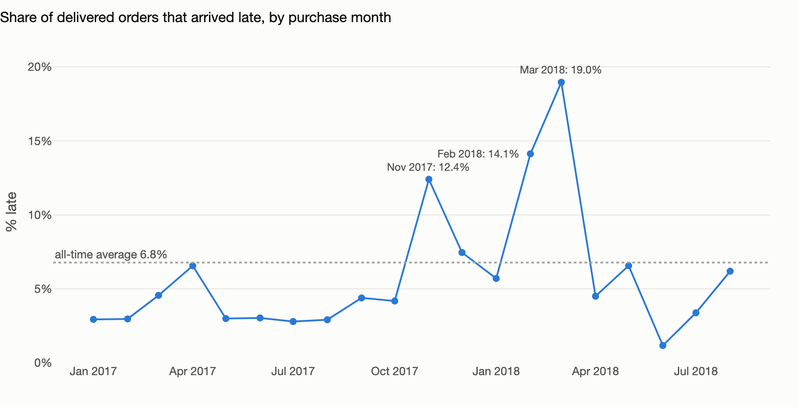
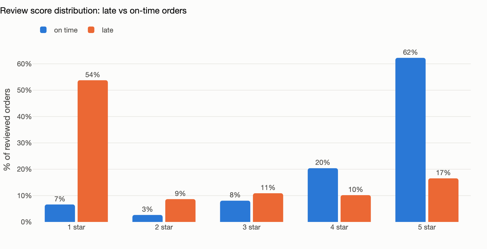
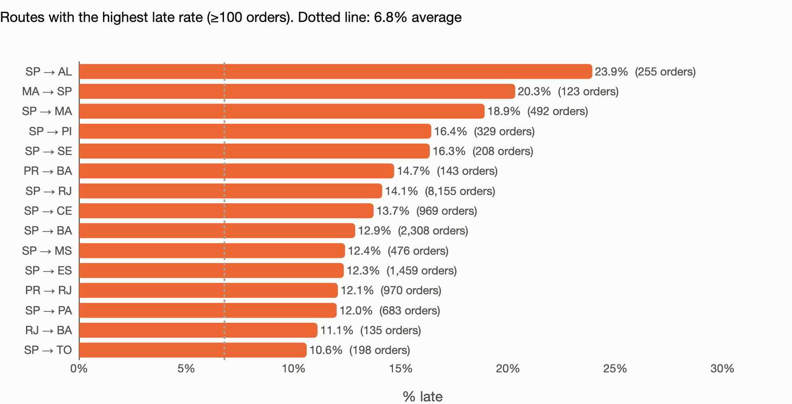
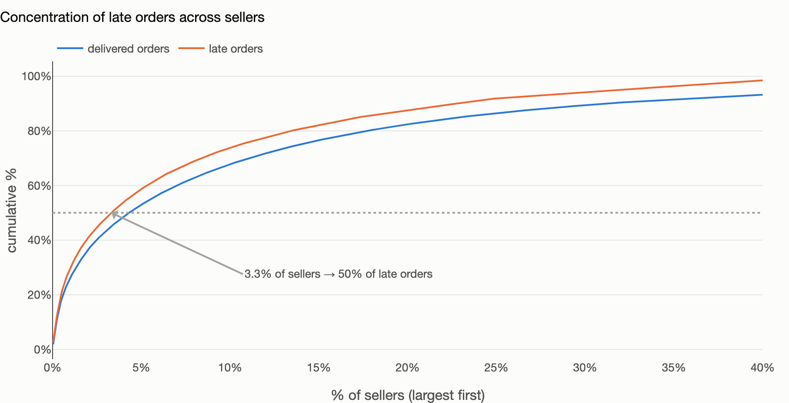
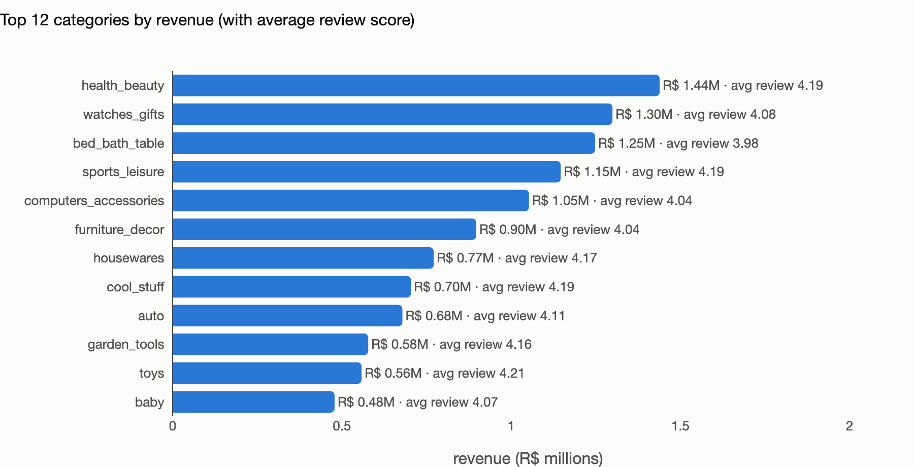
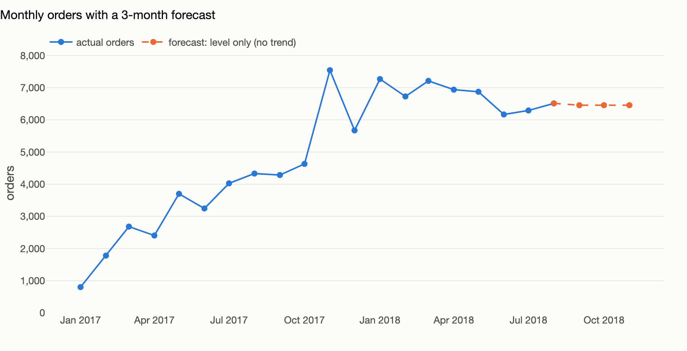

# Findings: delivery delays and customer reviews

Source: Olist marketplace orders, 2016-09 to 2018-10 (99,441 orders, 96,470 delivered).
All numbers come from `notebooks/01_business_questions.ipynb`, which queries the dbt marts.

**Definitions.** An order is *late* when it is delivered on a later calendar date than the date promised at
purchase. Late rates are calculated over delivered orders only. Trends use purchase months 2017-01 to 2018-08;
the months before and after have too few orders to be meaningful.

---

## 1. How big is the problem, and is it getting worse?

**Finding:** About 1 in 15 delivered orders arrives late, and almost half of all late orders come from just three months.

- 6.77% of delivered orders were late (6,534 of 96,470). When an order is late, the median delay is 7 days.
- The monthly late rate ranged from 1.2% (June 2018) to 19.0% (March 2018).
- November 2017 (12.4%), February 2018 (14.1%) and March 2018 (19.0%) together hold 48.4% of late orders in the
  trend window (3,158 of 6,531), but only 21.7% of delivered orders.

**So what:** Lateness is mostly a peak-period problem, not a constant one. Plan carrier capacity and set more
conservative promised dates ahead of known peaks (Black Friday, and whatever drove February to March 2018, which
the data does not explain). Track the late rate weekly so a spike is caught in days, not at month end.

## 2. Do late deliveries hurt reviews?

**Finding:** Yes, strongly. A late order scores about 2 stars lower on average, and the damage grows with the delay.

- Average review: 2.27 for late orders vs 4.29 for on-time orders (a gap of 2.02 points on a 5-point scale).
- 62.4% of late orders get 1 or 2 stars, vs 9.3% of on-time orders.
- Even 1–3 days late drops the average to 3.29; 4–7 days late drops it to 2.10.
- Late orders are 6.8% of deliveries but 32.5% of all 1–2 star reviews on delivered orders (3,983 of 12,272).

**So what:** Delivery reliability is one of the biggest controllable drivers of bad reviews. When an order is
going to miss its date, tell the customer before the date passes. The steep drop after only a few days suggests
proactive communication is worth testing first. (This is a correlation; an A/B test of proactive delay
messages would show how much of the drop is avoidable.)

## 3. Where does it come from: regions and routes

**Finding:** The Northeast and Rio de Janeiro have the highest late rates, and the São Paulo to Rio route produces
the most late orders of any cross-state route.

- Highest customer-state late rates: Alagoas (AL) 21.4%, Maranhão (MA) 17.4%, Sergipe (SE) 15.2%,
  Piauí (PI) 13.9%, Ceará (CE) 13.8%. São Paulo (SP), the biggest market, is at 4.5%.
- Rio de Janeiro (RJ) is the main volume problem: 12.1% late on 12,350 delivered orders, or 1,495 late orders.
- Of the 70 seller-to-customer routes with at least 100 delivered orders, the worst are SP → AL (23.9% of 255),
  MA → SP (20.3% of 123) and SP → MA (18.9% of 492).
- SP → RJ is 14.1% late on 8,155 orders, i.e. 1,152 late orders. Only SP → SP has more late orders (1,428), and
  that is at a low 4.6% rate on 30,727 orders.
- Cross-state orders are late 8.0% of the time vs 4.5% within the same state.
- Remote northern states (AM, AP, RO, AC) have some of the lowest late rates, because their promised times are
  very long (39 to 47 days on average). The promise is padded, not the delivery fast.

**So what:** Prioritise carrier SLAs on SP → RJ first (largest number of late orders), then the
SP → Northeast routes (AL, MA, PI, SE, CE), where the late rate is 2 to 3.5 times the average. For those routes,
either renegotiate with the carrier or add a few days to the promised date. A slightly longer promise that is
kept beats a short one that is missed.

## 4. Do a few sellers cause most late orders?

**Finding:** Late orders are concentrated, but mostly because sales are concentrated. A small group of large
sellers is behind half the late orders, and they are somewhat worse than average.

- 98 sellers (3.3% of the 2,958 sellers with delivered orders) account for 50% of late orders.
- For comparison, 128 sellers (4.3%) account for 50% of all delivered orders, so most of the concentration
  simply reflects volume.
- Those 98 sellers have a late rate of 8.1% vs 5.8% for all other sellers.
- 18 of the 418 sellers with 50+ delivered orders have a late rate of 15% or more; together they account for
  368 late orders.

**So what:** A seller programme is worth it, but it should be targeted. Work with the ~100 largest sellers on
handling time and carrier hand-off (a 2-point drop in their late rate would remove roughly 800 late orders on
this volume), and put the 18 high-volume, high-late-rate sellers on a performance plan with clear thresholds.

## 5. Which categories matter most?

**Finding:** Revenue is spread across many categories. Bed, bath & table is the one that combines high revenue
with weak reviews.

- Top revenue categories: health_beauty R$ 1.44M (9.1% of revenue), watches_gifts R$ 1.30M (8.3%),
  bed_bath_table R$ 1.25M (7.9%), sports_leisure R$ 1.15M (7.3%), computers_accessories R$ 1.05M (6.7%).
- Worst average review among categories with at least 500 reviewed orders: office_furniture 3.62
  (22.6% of reviews are 1–2 stars), the 'unknown' category 3.97, and bed_bath_table 3.98. The overall average is 4.09.
- office_furniture's late rate is 8.1%, only a little above the 6.8% average, so lateness alone does not
  explain its poor reviews. Product quality or assembly issues are more likely (to check in the review-text analysis).

**So what:** Focus quality work on bed_bath_table first: it is the third-largest category by revenue and among the
lowest rated, so improvements there affect the most customers. Investigate office_furniture separately as a
product or listing issue rather than a delivery one. Ask sellers to fill in the missing category on the
610 uncategorised products, which also score below average.

## 6. Forecast: how many orders to plan for?

**Finding:** Orders levelled off in 2018, and the best simple forecast is roughly flat at about 6,450 orders a month.

- Model: Holt-Winters exponential smoothing on 20 complete months (2017-01 to 2018-08), without a seasonal term
  because there is less than two years of history.
- Backtest (fit to May 2018, forecast June to August): the level-only version had 9.2% mean absolute percentage
  error. The damped-trend and linear-trend versions were much worse (28.9% and 37.4%) because they kept projecting
  the 2017 growth. A naive "repeat last month" forecast scored 8.7%, so the model is only as good as the simplest
  baseline.
- Forecast for September, October and November 2018: 6,456 orders each month (rough range 5,860 to 7,052, based on the backtest error).

**So what:** Use about 6,500 orders a month as the planning baseline for carrier capacity, but do **not** use it for
November. The model has no seasonality, and November 2017 was 63% above October. Plan Black Friday separately
from last year's uplift. With another year of data, a seasonal model would be the right next step.

## 7. Can we flag at-risk orders early?

**Finding:** Partly. A model that only uses information available at purchase finds 38.4% of late orders in the
riskiest 10% of orders (3.8 times better than random), tested on the most recent three months of data.

- Most of its signal comes from the promised delivery time: the shorter the promise, the higher the risk.
  The seller's and customer's states come next.
- Olist shortened its promised times sharply in mid-2018 (median 28 days in June, 14 in August), and short
  promises were missed far more often (11.6% late when promised within 10 days).
- Full results, the drivers explained in plain English and the limitations: [model_results.md](model_results.md).

**So what:** Use the score to give the operations team a short daily review list. The bigger lever is the
promise itself: shortening promised dates raises the late rate, so the trade-off between an attractive promise
and a kept promise should be a deliberate decision, made route by route.

## 8. What are unhappy customers complaining about?

**Finding:** Delivery problems are only part of the story. Wrong or incomplete orders are almost as common as
"not received" complaints, and most "not received" complaints come from customers still waiting for a late
order.

Method: a random sample of 400 of the 10,839 reviews scored 1–2 that have comment text. Each was labelled by
Gemini (`gemini-3.5-flash`) with an English translation, one main theme, and a confidence score. 380 were
labelled; the last batch of 20 hit the free-tier daily quota. With 380 reviews, each share below is accurate to
within about ±5 percentage points. Code: `src/review_themes.py`.

| Theme | Reviews | Share | Keyword baseline share |
|---|---|---|---|
| not_received | 116 | 30.5% | 28.4% |
| wrong_item | 108 | 28.4% | 11.3% |
| poor_quality | 45 | 11.8% | 5.3% |
| damaged_or_defective | 32 | 8.4% | 6.3% |
| seller_communication | 30 | 7.9% | 4.7% |
| other | 25 | 6.6% | 34.5% |
| late_delivery | 24 | 6.3% | 9.5% |

- Delivery problems (not_received + late_delivery) make up 36.8% of complaints. Product and fulfilment problems
  (wrong_item + damaged_or_defective + poor_quality) make up 48.7%.
- **"Wrong item" is often "incomplete order."** About half of the wrong_item reviews (50 of 108, by a simple
  word search of the translations) describe items missing from the order ("I bought 4 wheels and only 1
  arrived"). 69% of the sampled reviews on multi-item orders are wrong_item, vs 17% on single-item orders.
- **Checked against the delivery data, "not received" mostly means "late and still waiting."** Of the 116
  not_received reviews, 65 were on orders that were eventually delivered late (62 of those reviews were written
  before the parcel arrived), and 31 were on orders never delivered. The remaining 20 were on orders the data
  marks as delivered on time; several of these say the website showed "delivered" when nothing arrived.
- The two views agree from both directions. 78% of reviews on late orders are about delivery (not_received or
  late_delivery). 78% of reviews on on-time orders are about the product: wrong_item 46.7%, poor_quality
  18.9%, damaged_or_defective 12.3%.
- The keyword baseline agrees with Gemini on 53.7% of reviews. It leaves 34.5% unclassified ("other", vs 6.6%
  for Gemini) and finds only 30% of the wrong_item cases, because customers describe them in many ways
  ("veio outro", "só recebi um", "faltou").
- Accuracy against human labels is pending: 40 of these reviews are set aside in `data/labels/hand_labels.csv`
  for blind manual labelling, scored by `scripts/score_hand_labels.py`.

**So what:** Two cheap fixes would address most of these complaints. (1) Send a proactive "your order is
delayed" message before the promised date passes, since customers who write "not received" are mostly still
waiting for a late parcel. (2) Pick-and-pack checks for multi-item orders: a large share of "wrong item"
complaints are really items left out of the box. Also audit the carriers' proof of delivery on orders marked
delivered where the customer says nothing arrived.

---

## Limitations

- Late is measured against Olist's own promised date. Where the promise is padded, lateness looks low even if
  delivery is slow.
- Orders are attributed to a single main seller and main category (highest item value), which affects the
  1.3% of orders with several sellers.
- Reviews are correlated with lateness, but this analysis does not prove how much of the drop is caused by the delay itself.
- There is no carrier, warehouse or weather data, so the analysis can locate where delays happen but not
  their root cause.
