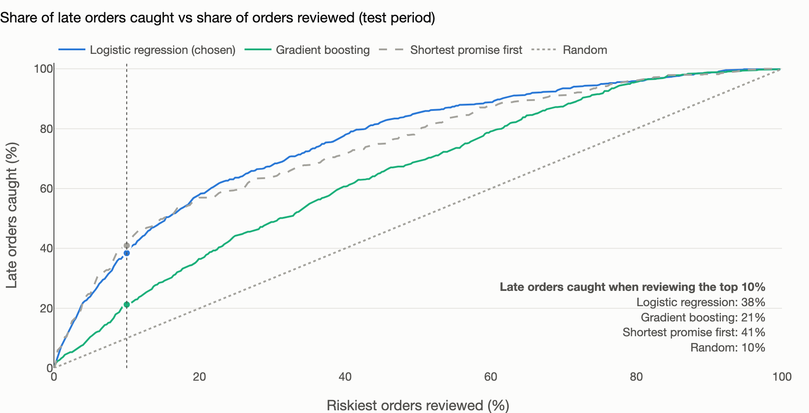
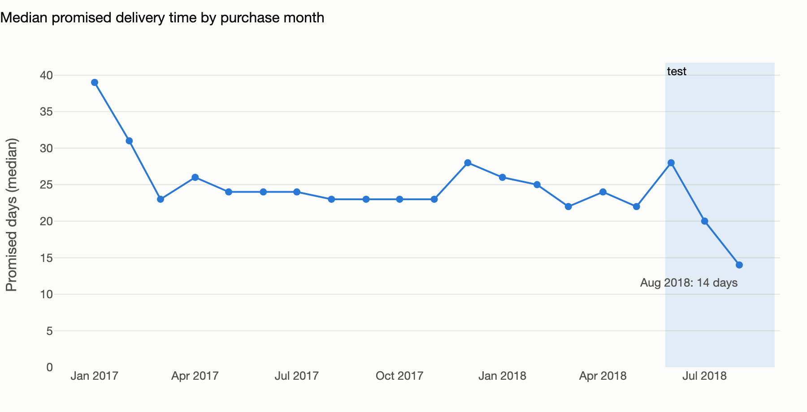
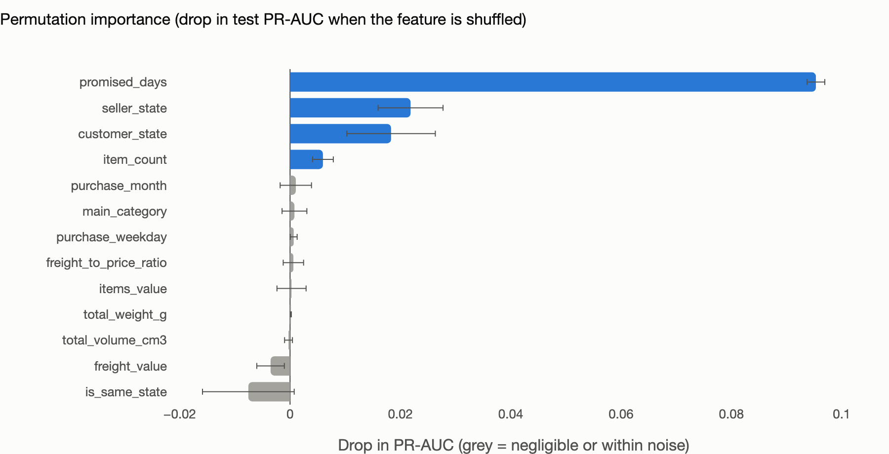

# Late-delivery risk model: results

Can we flag orders at risk of arriving late, at the moment they are placed?
Code: `src/features.py`, `src/train_model.py`. Full walk-through: `notebooks/02_late_delivery_model.ipynb`.

## Short answer

Partly. A simple model lets the operations team find **38% of late orders by reviewing only the riskiest 10%
of orders**, 3.8 times better than picking at random. That is useful for focusing a small team, but the model
misses most late orders, and 6 out of 7 flagged orders still arrive on time. Most of its signal comes from one
thing Olist controls itself: how short the promised delivery time is.

## Setup

| | |
|---|---|
| Target | `is_late` (delivered on a later calendar date than promised), delivered orders only |
| Features | promised delivery days, items value, freight value, freight-to-price ratio, item count, total weight, total volume, product category, customer state, seller state, same-state flag, purchase month, purchase weekday |
| Not used (leakage) | review data, approval and carrier hand-off times, actual delivery date |
| Train | 77,176 orders, 2016-09-15 to 2018-05-26, 7.59% late |
| Validation | newest 20% of train (15,436 orders, 2018-03-20 to 2018-05-26, 6.69% late), used for settings and model choice |
| Test | newest 19,294 orders, 2018-05-26 to 2018-08-29, 3.49% late (674 late orders), scored once |
| Class imbalance | `class_weight="balanced"` in both models; evaluated with ranking metrics, not accuracy |

**Why a time-based split:** the model will always be trained on past orders and used on future ones. A random
split lets it learn from the same weeks it is tested on, which flatters it. On a random split, gradient
boosting looked like the better model (ROC-AUC 0.78, 39% caught in the top 10%). On the time split it dropped
to 0.65 and 21%.

## Results

Test period (the model was chosen on the validation slice before these numbers were computed):

| | ROC-AUC | PR-AUC | Late orders caught in top 10% | Late rate inside top 10% |
|---|---|---|---|---|
| **Logistic regression (chosen)** | **0.770** | **0.129** | **38.4%** (259 of 674) | 13.4% |
| Gradient boosting | 0.654 | 0.064 | 21.2% | 7.4% |
| Rule: shortest promise first | 0.750 | 0.120 | 41.0% | 14.3% |
| Random | 0.500 | 0.035 | 10.0% | 3.5% |

Validation slice (used to choose):

| | ROC-AUC | PR-AUC | Late orders caught in top 10% |
|---|---|---|---|
| Logistic regression | 0.682 | 0.161 | 30.2% |
| Gradient boosting (best of 8 settings) | 0.652 | 0.160 | 28.8% |
| Rule: shortest promise first | 0.515 | 0.066 | 6.1% |
| Random | 0.500 | 0.067 | 10.0% |

By test month, the chosen model catches 36.6% (June), 35.6% (July) and 29.8% (August) of late orders in its
top 10%.

### Why the simple model beat gradient boosting

Olist shortened its promised delivery times sharply in mid-2018: the median promise fell from 28 days in June
to 14 days in August. In the training period the late rate barely depends on the promise; in the test period it
depends on it strongly (11.6% late when promised within 10 days, 0.6% when promised over 40 days).

Logistic regression can only learn "shorter promise means more risk" as one direction, and that direction
carried over to the new period. Gradient boosting learned the detailed shape of the training-period pattern,
which did not carry over. When the data drifts, the simpler model generalises better.

### The honest caveat

On the test period, the one-line rule "sort by promised days, shortest first" is about as good as the model.
On the validation period that same rule was no better than random, while the model worked in both periods.
So the model is the safer choice, but on recent data it adds little on top of the promised date.

## What drives the score

Permutation importance on the test period (drop in PR-AUC when one feature is shuffled, 10 repeats):

| Feature | PR-AUC drop |
|---|---|
| promised_days | 0.0953 |
| seller_state | 0.0218 |
| customer_state | 0.0183 |
| item_count | 0.0060 |
| purchase_month | 0.0010 (within noise) |
| all other features | below 0.001, or negative |

**The top 5 drivers in plain English**

1. **Promised delivery time (by far the most important).** The shorter the promise, the higher the risk.
   Orders promised within 10 days were late 11.6% of the time in the test period, vs under 1% for orders
   promised more than 30 days. A tight deadline leaves no slack for a slow seller or a carrier delay, and this is
   something Olist sets itself.
2. **Seller state.** Where the parcel starts matters. Sellers in Maranhão (MA) are the clearest risk (11.1% of
   their test-period orders were late). São Paulo sellers also score above average: SP ships to the whole
   country, and its long routes (to Rio and the Northeast) produced the most late orders in training.
3. **Customer state.** Where the parcel goes matters too. The model learned that Northeast and North states
   (Alagoas, Roraima, Sergipe, Pará, Bahia, Ceará) are risky destinations, and São Paulo, Minas Gerais and
   Paraná are safe. This pattern was weaker in the test period, which is one reason the model is only moderately good.
4. **Number of items.** Orders with 2 or more items are slightly *less* likely to be late (1.9% vs 3.6% for
   single-item orders in the test period). The effect is small, and I can't explain it from this data.
5. **Purchase month (weak).** The model learned that November, February and March are high-risk (Black Friday
   and the early-2018 peak). The test period only covers May to August, so this adds almost nothing here.

Price, freight, weight, volume, category and weekday add little once the promise and route are known.
`is_same_state` has *negative* importance on the test period. Same-state orders were less likely to be late in
training (4.3% vs 9.3%), but more likely in the test period (5.1% vs 2.4%). That is because 34% of same-state
test orders got the new short promises (within 10 days), vs 4% in training.

**Explaining one flagged order to a client** (a real test-period order, ranked 5th of 19,294, which did arrive
late): "This order was promised in 8 days, far shorter than most orders (the median in this period was 21 days).
It ships from São Paulo to Rio de Janeiro, a route that has produced more late orders than almost any other.
That combination is why it is near the top of today's list."

## Limitations

- **Missing causes.** The main causes of lateness are not in the data: carrier, warehouse delays, weather,
  strikes, stock-outs. The model only sees the order, the product and the route.
- **Peaks can't be predicted from order details.** Black Friday 2017 and the February to March 2018 peak hit all
  kinds of orders at once. A weekly late-rate monitor is a better tool for those than an order-level model.
- **Drift.** The promise policy changed in mid-2018, so any deployed model would need monthly retraining and
  a check on fresh validation data.
- **Scores rank orders; they are not probabilities.** Class weighting inflates the scores, so a score of 0.6
  does not mean a 60% chance of being late. They would need calibrating before being read as probabilities.
- **A few orders are missing from the test set.** Orders still in transit when the data was extracted aren't
  in it (only 47 August 2018 orders were still marked as shipped), so the test late rate may be slightly understated.

## Next steps

- Seller history features: each seller's late rate and dispatch time over the previous 90 days, calculated
  only from earlier orders so there is no leakage.
- Carrier and shipping-method data, if available.
- Monthly retraining with the same time-based validation.
- Probability calibration on the validation slice if the team needs real probabilities.

## Output

`app/data/late_risk_scores.parquet`: the 19,294 test-period orders with the chosen model's `risk_score`,
`risk_percentile`, `flagged_top_10pct` and the actual `is_late`, for the dashboard's Late-Risk Model tab.
